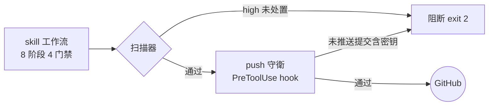

# Safe GitHub Publish

为 ZCode / Claude Code 类 agent 准备的安全发布套装：skill 以阶段门禁完成密钥与隐私审查、生成工整的发布产物；PreToolUse 守衛在任何推送前做最后拦截。

[](https://github.com/XIAOXINYIHUA/safe-github-publish-v2/actions/workflows/tests.yml)


## 功能

- **阶段门禁工作流**：8 阶段 4 硬门禁（安全扫描 → 格式检查 → 复扫 → public 专项确认），退出码 2 不可绕过
- **四模式扫描**：工作区 / 全部 Git 历史（含已删除文件中的密钥）/ staged / 未推送提交
- **push 守衛**：拦截 `git push` 与 `gh` 发布命令；密钥提交后再 revert 依旧可拦——密钥仍在未推送历史中
- **误报基线**：人工审核的豁免项记录 rule / path / reason / 日期，禁止自动填充
- **格式门禁**：README 结构、相对链接大小写（GitHub 区分大小写）、Mermaid 校验、空章节与 badge 上限
- **发布产物**：README 模板、Conventional Commits、语义化标签、Keep a Changelog、topics 与许可证对照

## 三道防线

工作流门禁依赖 agent 遵循流程；后两道是确定性机制，不依赖任何自觉。



## 安装

**plugin（推荐，含 push 守衛）**：Plugin Marketplace → Add，添加本仓库，安装 `safe-github-publish`。

**仅 skill**：

```bash
git clone https://github.com/XIAOXINYIHUA/safe-github-publish-v2.git
cp -r safe-github-publish-v2/skills/safe-github-publish ~/.agents/skills/
```

## 使用

对 agent 说一句即可触发：`帮我把这个项目发布到 GitHub`。

工具脚本可独立运行（Windows 用 `py -3`）：

```console
$ python3 skills/safe-github-publish/scripts/security_scan.py . --scan-history
HIGH src/old_config.py:1 credential-assignment [history@a1b2c3d4e5]
Summary: high=6 medium=5 history_scanned=True; 命中值未被打印。

$ python3 skills/safe-github-publish/scripts/repo_lint.py .
ERROR [link-case] 链接大小写不匹配: assets/screen.PNG → 实际是 assets/screen.png
Summary: error=1 warn=2 info=1
```

输出只含路径、行号、规则名与 commit 摘要，不打印命中的敏感值——这一点有专门的单元测试断言。

## v1 → v2

| 维度 | v1 | v2 |
|---|---|---|
| 工作流 | 线性 8 步清单 | 8 阶段 4 硬门禁 |
| Git 历史扫描 | 不支持 | `--scan-history` / `--unpushed` |
| 提交前防线 | 无 | `--staged` + push 守衛 hook |
| 误报处置 | 人工忽略 | 审核基线（reason + 日期） |
| 发布格式 | 仅 README 模板 | repo_lint 确定性门禁 + 格式规范 |
| 测试 | 8 个 | 27 个 + CI 四矩阵 |

## 目录结构

```text
safe-github-publish/
├── .zcode-plugin/plugin.json      # plugin 清单（skill + hooks）
├── .github/workflows/tests.yml    # CI：Ubuntu / Windows × Python 3.11 / 3.13
├── hooks/                         # push 守衛（PreToolUse）
└── skills/safe-github-publish/
    ├── SKILL.md                   # 工作流核心：8 阶段 4 门禁
    ├── scripts/                   # security_scan.py / repo_lint.py
    ├── references/                # 隐私清单、README 模板、发布格式、洩露应急
    ├── assets/                    # 防复发：gitleaks / pre-commit / CI 模板
    └── tests/                     # 27 个单元测试
```

## 安全边界

覆盖：tracked 与未忽略的 untracked 文件、历史 / staged / 未推送提交的新增行、JPEG 与 PNG 的 EXIF 存在性、符号链接与嵌套仓库。

不覆盖：二进制与压缩包内部、Git LFS 对象、远程系统；历史扫描超过 200MB 会截断并如实提示，不静默跳过。不宣称"完全安全"，只报告已检查范围与剩余风险。

## 开发

```bash
python -m unittest discover -s skills/safe-github-publish/tests -v
echo '{"tool_name":"Bash","tool_input":{"command":"git push"}}' | bash hooks/push_guard.sh
```

详细文档：[skills/safe-github-publish/README.md](skills/safe-github-publish/README.md) · 变更记录：[CHANGELOG.md](CHANGELOG.md)

## 许可证

[MIT](LICENSE) © 2026 XIAOXINYIHUA
