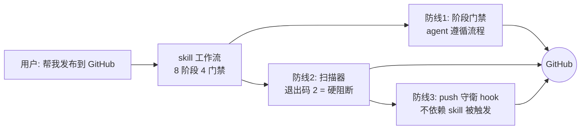

# Safe GitHub Publish

> 给 ZCode / Claude Code 类 agent 的安全发布套装：**一个 skill + 一道主动防线**，让"帮我发到 GitHub"这句话不再等于"帮我泄露密钥"。

[](https://github.com/XIAOXINYIHUA/safe-github-publish-v2/actions/workflows/tests.yml)


**tests: Ubuntu + Windows × Python 3.11/3.13 全绿 · 27 个单元测试 · 扫描器输出零敏感值泄露（有测试断言）**

## 目录

- [✨ 功能特性](#-功能特性)
- [🧭 三道防线](#-三道防线)
- [📦 安装](#-安装)
- [🚀 快速开始](#-快速开始)
- [🆚 v1 → v2 升级对照](#-v1--v2-升级对照)
- [📁 目录结构](#-目录结构)
- [🔒 安全边界](#-安全边界)
- [🛠️ 开发](#-开发)
- [📄 许可证](#-许可证)

## ✨ 功能特性

- **阶段门禁工作流**——8 个阶段、4 道硬门禁（安全扫描 → 格式检查 → 复扫 → public 专项确认），上一关不过不放行，退出码 2 不可绕过
- **四模式深度扫描**——工作区 / `--scan-history`（全部 Git 历史，连已删除文件里的密钥也能抓到）/ `--staged`（提交前最后一眼）/ `--unpushed`（只扫未推送提交）
- **push 守衛**——PreToolUse hook 拦截 `git push` / `gh repo create` / `gh release create|upload`，存在未处置高风险项直接阻断；**先提交密钥再 revert 也拦得住**，因为密钥还在未推送历史里
- **误报基线机制**——`.safe-publish-baseline.json` 记录人工审核过的豁免项（rule/path/line/reason/date），只允许人工添加，不为过门禁而自动填充
- **发布格式门禁**——`repo_lint.py` 校验 README 结构、快速开始章节、**相对链接大小写**（GitHub 是 Linux，大小写错了直接 404）、Mermaid 图表类型、空章节、badge 上限
- **工整的发布产物**——README 模板（价值→证据→行动→细节→信任）、Conventional Commits、语义化标签、Keep a Changelog、topics/描述规范、许可证对照表
- **洩露应急手册**——先轮换密钥、再评估暴露面、经用户确认才清理历史，拒绝"清了历史就没事"的错误方案
- **防复发三件套**——gitleaks 配置 / pre-commit 钩子 / CI 扫描模板，发布完成后复制进用户项目，防线持续存在

## 🧭 三道防线



1. **工作流门禁**：skill 触发时，agent 按 SKILL.md 的阶段与准出条件执行
2. **确定性扫描**：不依赖 agent 自觉——扫描器退出码是硬信号，high 未处理就是过不去
3. **主动拦截**：就算绕过 skill 直接让 agent 推送，PreToolUse hook 也会先扫未推送提交再放行

## 📦 安装

**方式一：plugin（推荐，含 push 守衛）**

1. Plugin Marketplace → Add → Add Plugin Marketplace，粘贴本仓库（或本地 `plugins/` 目录）
2. 安装 `safe-github-publish`

**方式二：仅 skill**

```bash
git clone https://github.com/XIAOXINYIHUA/safe-github-publish-v2.git
cp -r safe-github-publish-v2/skills/safe-github-publish ~/.agents/skills/
```

## 🚀 快速开始

装好后对 agent 说一句即可触发：

```text
帮我把这个项目发布到 GitHub
```

工具脚本也可以独立使用（Windows 用 `py -3`）：

```console
$ python3 skills/safe-github-publish/scripts/security_scan.py . --scan-history
HIGH src/old_config.py:1 credential-assignment [history@a1b2c3d4e5]
Summary: high=6 medium=5 history_scanned=True; 命中值未被打印。

$ python3 skills/safe-github-publish/scripts/repo_lint.py .
ERROR [link-case] 链接大小写不匹配: assets/screen.PNG → 实际是 assets/screen.png（GitHub 区分大小写）
Summary: error=1 warn=2 info=1
```

注意：输出**永远只含路径、行号、规则名与 commit 摘要**，不会打印命中的敏感值——这一点有专门的单元测试断言。

## 🆚 v1 → v2 升级对照

| 维度 | v1 | v2 |
|---|---|---|
| 工作流 | 线性 8 步清单 | 8 阶段 4 硬门禁 |
| Git 历史扫描 | ❌ 明确声明做不到 | ✅ `--scan-history` / `--unpushed` |
| 提交前防线 | ❌ | ✅ `--staged` + push 守衛 hook |
| 误报处置 | 人工忽略 | ✅ 审核基线（reason + 日期） |
| 发布格式 | 仅 README 模板 | ✅ repo_lint 确定性门禁 + 发布格式规范 |
| 密钥规则 | 基础供应商 | ✅ 熵值检测 / EXIF / 锁文件降噪 / 10+ 新供应商 |
| 测试 | 8 个 | ✅ 27 个 + CI 四矩阵 |

## 📁 目录结构

```text
safe-github-publish/
├── .zcode-plugin/plugin.json      # plugin 清单（skill + hooks）
├── .github/workflows/tests.yml    # CI：Ubuntu/Windows × Python 3.11/3.13
├── hooks/
│   ├── hooks.json                 # PreToolUse 钩子注册
│   ├── push_guard.sh              # 跨平台解释器选择（py -3 / python3）
│   └── push_guard.py              # push 守衛本体
└── skills/safe-github-publish/
    ├── SKILL.md                   # 8 阶段 4 门禁工作流（核心，105 行路由）
    ├── scripts/
    │   ├── security_scan.py       # 四模式安全扫描器（460+ 行）
    │   └── repo_lint.py           # 发布格式检查
    ├── references/                # 按需加载的 4 份手册
    │   ├── privacy-checklist.md   #   隐私清单 + 基线机制 + 历史处置
    │   ├── readme-template.md     #   README 编排指南（三种项目类型）
    │   ├── release-format.md      #   提交/标签/CHANGELOG/topics/许可证
    │   └── leak-response.md       #   洩露应急（先轮换再清理）
    ├── assets/                    # 防复发三件套模板
    │   ├── gitleaks.toml
    │   ├── pre-commit-config.yaml
    │   └── ci-gitleaks.yml
    └── tests/                     # 27 个单元测试
```

## 🔒 安全边界

**如实声明覆盖范围**：tracked + 未忽略的 untracked 文件、Git 历史/staged/未推送提交的新增行、JPEG/PNG EXIF 存在性、符号链接与嵌套仓库。

**明确不覆盖**：二进制文件内部、压缩包内部、Git LFS 对象、远程系统、超过 200MB 被截断的历史——截断时会如实提示，绝不静默跳过。

我们不宣称"完全安全"，只报告已检查范围与剩余风险。

## 🛠️ 开发

```bash
python -m unittest discover -s skills/safe-github-publish/tests -v   # 27 个测试
```

守衛手动验证：

```bash
echo '{"tool_name":"Bash","tool_input":{"command":"git push"}}' | bash hooks/push_guard.sh
```

详细设计文档见 [skills/safe-github-publish/README.md](skills/safe-github-publish/README.md)，变更记录见 [CHANGELOG.md](CHANGELOG.md)。

## 📄 许可证

[MIT](LICENSE) © 2026 XIAOXINYIHUA
