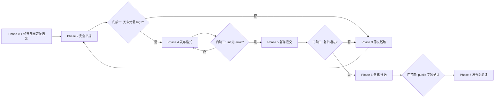

# Safe GitHub Publish

一个保证安全、产出工整格式的 GitHub 自动化发布 skill：分阶段门禁式审查密钥与隐私（含 Git 历史），再生成规范的 README、CHANGELOG、LICENSE 决策与仓库元数据，最后创建或推送仓库。

## Highlights

- **阶段门禁工作流**：侦察 → 圈定候选集 → 安全扫描 → 修复脱敏 → 发布格式 → 暂存提交 → 推送 → 验证，8 个阶段 4 道硬门禁，上一关不过不放行
- **深度扫描**：工作区 + `--scan-history`（全部 Git 历史，连已删除文件里的密钥也能抓到）+ `--staged`（staged diff）+ `--unpushed`（仅未推送提交）四重模式，支持 gitleaks/trufflehog 已安装时优先使用
- **主动防线**：以 plugin 安装时自带 PreToolUse 守衛——任何 `git push` / `gh repo create` / `gh release create|upload` 前自动扫描未推送提交，high 阻断（连"先提交密钥再 revert"也拦得住，因为密钥仍在未推送历史里）
- **绝不泄值**：输出只含相对路径、行号、规则名与 commit 摘要，测试明确断言不泄露命中值与根目录
- **误报基线**：`.safe-publish-baseline.json` 记录人工审核过的豁免项（含 reason 与日期），不为通过门禁而自动填充
- **格式工整**：`repo_lint.py` 校验 README 结构、快速开始章节、相对链接大小写（GitHub 区分大小写）、Mermaid 图表类型、空章节与 badge 数量
- **洩露应急**：内置手册——先轮换密钥、再评估暴露面、经确认才清理历史，拒绝"清了历史就没事"的错误方案

## Quick start

要求 ZCode / Claude Code 类 agent：

```text
帮我把这个项目发布到 GitHub
```

skill 会自动触发。也可以显式调用工具脚本：

```console
$ python scripts/security_scan.py . --scan-history
HIGH src/old_config.py:1 credential-assignment [history@289c020eda]
Summary: high=6 medium=5 history_scanned=True; 命中值未被打印。

$ python scripts/repo_lint.py .
ERROR [link-case] 链接大小写不匹配: assets/screen.PNG → 实际是 assets/screen.png（GitHub 区分大小写）
Summary: error=1 warn=2 info=1
```

安装两种形态任选：

- **仅 skill**：把 `skills/safe-github-publish/` 复制到 `~/.agents/skills/`（或项目内 `.zcode/skills/`）
- **完整 plugin（推荐，含 push 守衛）**：通过本地 marketplace 安装（见仓库根的 `.zcode-plugin/plugin.json` 与 `hooks/`）

## How it works



目录结构：`SKILL.md` 是路由与工作流；`scripts/` 是两个可独立运行的确定性门禁脚本；`references/` 是按需加载的四份手册（隐私清单 / README 模板 / 发布格式 / 洩露应急）；`assets/` 是防复发三件套模板（gitleaks 配置、pre-commit、CI 扫描）。

## 安全边界

- 默认创建 private 仓库；public 需用户明确要求并做推送前最终确认
- 不自动强推、改写历史、覆盖 remote 或添加许可证
- 扫描不覆盖：二进制内部、压缩包、Git LFS 对象、远程系统；历史超 200MB 会截断并如实提示
- 不宣称"完全安全"，只报告已检查范围与剩余风险

## Development

```bash
python -m unittest discover -s tests -v   # 25 个测试：规则命中、历史/staged/unpushed 扫描、基线、输出安全、格式检查
```

CI（Ubuntu + Windows × Python 3.11/3.13）见仓库根 `.github/workflows/tests.yml`；密钥扫描模板见 `assets/ci-gitleaks.yml`。

## License

MIT —— 见仓库根 [LICENSE](../../LICENSE) 文件。
